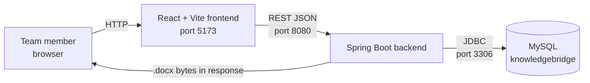
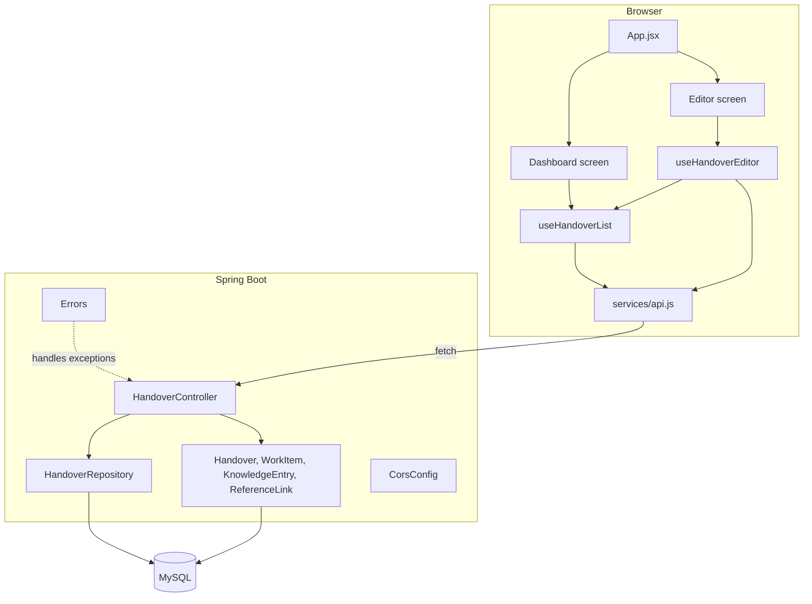
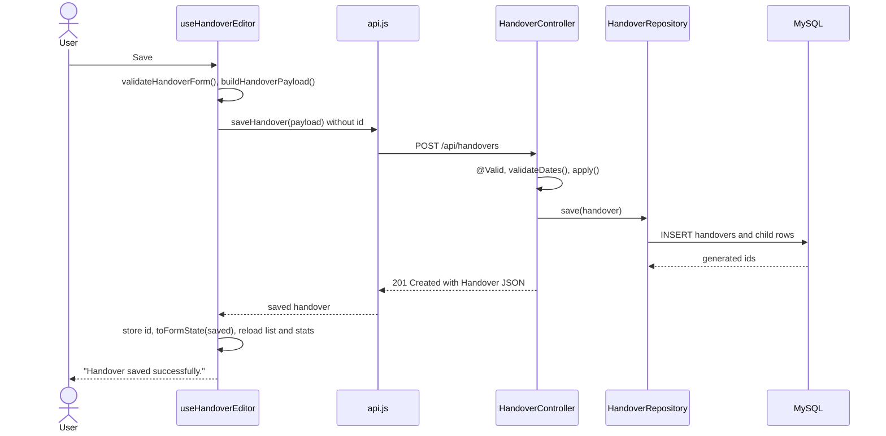
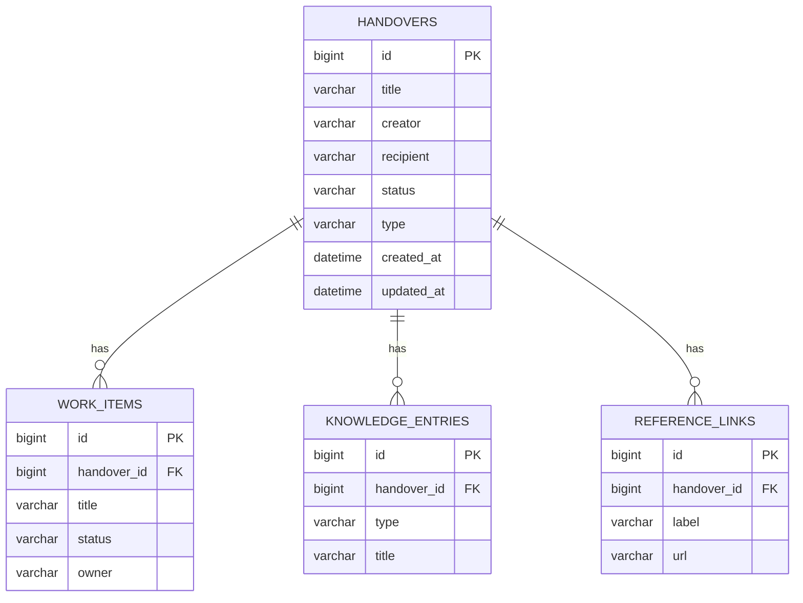

# KnowledgeBridge Project Documentation

This document describes the KnowledgeBridge codebase in this repository. Statements are based on the source files named in each section. Items marked **Unverified** were not confirmed from source or at runtime. Items marked **Confirmed live** were checked against the running backend in this session.

## Table of Contents

- [Document purpose and audience](#document-purpose-and-audience)
- [Quick start for new developers](#quick-start-for-new-developers)
- [Part I: Product overview](#part-i-product-overview)
- [Part II: How the product works](#part-ii-how-the-product-works)
- [Part III: System architecture](#part-iii-system-architecture)
- [Part IV: Frontend technical reference](#part-iv-frontend-technical-reference)
- [Part V: Backend technical reference](#part-v-backend-technical-reference)
- [Part VI: Database and persistence](#part-vi-database-and-persistence)
- [Part VII: Configuration and environment setup](#part-vii-configuration-and-environment-setup)
- [Part VIII: Security and reliability](#part-viii-security-and-reliability)
- [Part IX: Testing and quality assurance](#part-ix-testing-and-quality-assurance)
- [Part X: Maintenance and extension guide](#part-x-maintenance-and-extension-guide)
- [Part XI: Architecture decisions and reference](#part-xi-architecture-decisions-and-reference)

---

## Document purpose and audience

This is the reference for KnowledgeBridge. It is written for:

- Developers who build, debug, or extend the frontend or backend.
- Technical leads who review design and risks.
- Testers who need to know what is implemented and what to verify.
- New team members who need product context before reading code.

When this document and the code disagree, the code is authoritative and this document should be corrected.

Location: this file sits in the `knowledgebridge/` folder, next to `README.md`, `QUICK_START.md`, the `backend/` Maven project, and the `frontend/` npm project. The repository has no single root build file, so this folder was chosen as the project root.

---

## Quick start for new developers

Prerequisites: JDK 17 or newer (the Maven build targets release 17), Maven, Node.js `^20.19.0` or `>=22.12.0`, and a local MySQL server. The README documents MySQL 8 compatibility; the repository does not pin a version.

1. Start MySQL and create the database (see [Part VII](#part-vii-configuration-and-environment-setup)).
2. Start the backend from `knowledgebridge/backend`:

   ```powershell
   mvn spring-boot:run
   ```

   The API listens on `http://localhost:8080/api/handovers` by default. Health check: `http://localhost:8080/actuator/health`.
3. Start the frontend from `knowledgebridge/frontend`:

   ```powershell
   npm install
   npm run dev
   ```

   Open `http://localhost:5173`. Vite may choose `5174` if `5173` is busy.

Note: `QUICK_START.md` describes backend port `8081` and frontend port `5174`. Those values do not match the backend defaults. The frontend default API URL is `http://localhost:8080/api/handovers`, and `frontend/.env.local` in this workspace sets the same value.

---

## Part I: Product overview

### Executive summary

KnowledgeBridge is a local-first web application for recording handovers. A handover captures who is passing on work and to whom, the work items that are open, blocked, or done, the decisions, issues, workarounds, dependencies, and open questions the next person needs, and reference links. The app checks a handover for missing context and exports it as a Word (`.docx`) file.

It is a proof of concept. It runs on a developer or team workstation with a local MySQL database. It has no authentication or authorization (see [Part VIII](#part-viii-security-and-reliability)).

### Business problem

When someone leaves a project, changes role, goes on leave, or transfers responsibility, context is often lost. Work status lives in people's heads, decisions are not recorded, and blockers surface late. KnowledgeBridge gives the outgoing owner a structured place to record that context and a rule-based check before the handover is marked ready.

### Goals, scope, and boundaries

| Area | Implemented | Not implemented |
|---|---|---|
| Handover records | Create, read, update, delete | Version history, revert, audit trail |
| Context capture | Work items, knowledge notes, reference links | File attachments |
| Quality check | Rule-based completeness check with findings | AI or semantic analysis |
| Sharing | Status field (UI offers `DRAFT`, `READY`, `SHARED`) and Word export | Email, notifications, user accounts, access control |
| Discovery | Server-side search, status and type filters, pagination | Full-text index, saved searches |
| Platform | Single local backend and database | Multi-user hosting, Docker, cloud deployment |

### Key users and roles

The implementation has no user accounts or roles. `creator` and `recipient` are free text. Roles below describe how the workflow is used:

| Role | Responsibilities in the product |
|---|---|
| Outgoing owner (creator) | Creates the handover, records work items, notes, and links, runs the completeness check, exports the document. |
| Incoming owner (recipient) | Named in the `recipient` field. The app does not notify or grant access. |
| Reviewer | Searches, filters, and reads handovers. No review workflow exists. |
| Developer | Runs and maintains the local stack. |

### Core features

- Dashboard with a paginated list sorted by most recently updated.
- Search across title, creator, recipient, and summary.
- Filters by workflow status and handover type.
- Editor with details, work items, knowledge notes, and references.
- Completeness check with warning and informational findings.
- Word export.
- Delete with a browser confirmation.
- Actuator health endpoint.

### Terminology

| Term | Meaning |
|---|---|
| Handover | Top-level record. Entity `Handover`, table `handovers`. |
| Creator | Free-text name of the person preparing the handover. Required. |
| Recipient | Free-text name of the person receiving it. Optional. |
| Handover type | UI offers `LEAVE`, `PROJECT_TRANSITION`, `ROLE_CHANGE`, `RESPONSIBILITY_TRANSFER`. Stored as free text on the backend. |
| Workflow status | UI offers `DRAFT`, `READY`, `SHARED`. Stored as free text on the backend. |
| Work item | Task or follow-up. Entity `WorkItem`, table `work_items`. |
| Work item status | UI offers `NOT_STARTED`, `IN_PROGRESS`, `BLOCKED`, `COMPLETED`. Stored as free text on the backend. |
| Knowledge entry | Note with a type such as `DECISION`, `ISSUE`, `WORKAROUND`, `DEPENDENCY`, `OPEN_QUESTION`, `GENERAL`. Entity `KnowledgeEntry`, table `knowledge_entries`. |
| Reference link | Labeled URL. Entity `ReferenceLink`, table `reference_links`. |
| Completeness check | Backend rule evaluation returning `ready`, `warningCount`, `findings`. |

The knowledge entry type list above comes from the frontend constants file (`constants.js`) as named in the earlier review; the backend does not validate it. **Unverified** for the exact list.

### Implemented versus planned

| Capability | Status | Evidence |
|---|---|---|
| Create, read, update, delete handovers | Implemented | `HandoverController.java` |
| Nested work items, knowledge entries, references saved with the handover | Implemented | `HandoverController.apply()`, `Handover.children()` |
| Server-side pagination (sizes 10, 20, 50) | Implemented | `HandoverController.all()` |
| Search and status/type filters | Implemented | `HandoverRepository.java`, `FilterBar.jsx` |
| Completeness check | Implemented | `HandoverController.completeness()`, `ReadinessCard.jsx` |
| Word export | Implemented | `HandoverController.export()`, `useHandoverEditor.js` |
| Dashboard statistics | Implemented with a defect (see [Part IX](#known-defects-and-risks)) | `useHandoverList.js` |
| Frontend automated tests | Not implemented | `frontend/package.json` has no test script |
| Authentication and authorization | Not implemented | No security dependency in `backend/pom.xml` |
| Audit logging, version history | Not implemented | No such code |
| Enforced status transitions | Not implemented | Backend accepts any status string |
| Docker or CI configuration | Not present | No such files found in the workspace |

---

## Part II: How the product works

### Handover status

The `status` field is set by the user. The backend accepts any value and does not enforce transitions. Setting `SHARED` changes only the stored label. No code path sends anything to the recipient.

### Creating a handover

1. The user opens a new editor. `useHandoverEditor.create()` resets the form to `blankForm()`, clears the id, and switches the screen to the editor.
2. The user fills in the details and the work, knowledge, and references tabs.
3. The user clicks save. `save()` runs `validateHandoverForm()`. If it fails, the error is shown and nothing is sent.
4. If valid, `buildHandoverPayload()` shapes the payload. `api.saveHandover()` sends `POST /api/handovers` when there is no id, or `PUT /api/handovers/{id}` when there is one.
5. The response updates the id and form (`toFormState(saved)`), reloads the list and stats, and shows the notice "Handover saved successfully."

### Opening and editing

- Opening a handover calls `GET /api/handovers/{id}`, converts the result with `toFormState()`, sets the id, clears the findings, and opens the editor on the work tab.
- **Clear form** (`clearForm()`) resets only the local form and id. It does not delete anything from the database.

### Work items, ownership, and recipients

- Work items are a repeatable list. Each has title, status, owner, due date, description, completed work, next action, and blocker. The blocker field is shown when the status is `BLOCKED` (**Unverified** for the exact UI condition).
- Ownership is a free-text `owner` field per work item. No user lookup exists.
- Recipient is one free-text field on the handover.
- Removing a work item removes it from the form. The database changes on the next save, because the backend replaces the whole child collection (see [Part V](#business-rules-and-invariants)).

### Dashboard list, pagination, search, and filters

- **Load:** `loadPage(pageNum, size)` requests `GET /api/handovers` with `sort=updatedAt` and `direction=DESC`, plus any active search and filters.
- **Pagination controls:** First, Previous, Next, and Last buttons, a page label, and a per-page select with 10, 20, and 50. First and Previous are disabled on the first page. Next and Last are disabled on the last page.
- **Page size change:** `handlePageSizeChange()` sets the new size and resets to page 1.
- **Search:** `handleSearch()` debounces input and reloads page 1. Search matches title, creator, recipient, and summary, case-insensitively. Work items and knowledge notes are not searched.
- **Filters:** status and type changes reload page 1. `ALL` sends no filter.
- **Clear filters:** resets search and both filters.
- **Refresh:** reloads the current page.
- **Empty states (verified strings):** "Loading your workspace…" while loading, "No matching handovers" when filters return nothing, and "Your workspace starts here" when there are no handovers.

Confirmed live in this session (17 handovers in the database): size 10 returned 10 items on page 1 and 7 on page 2; sizes 20 and 50 returned all 17 on one page; a search with no match returned `totalElements=0`.

### Dashboard statistics (defect)

`useHandoverList.js` computes the stat cards from `GET /api/handovers?page=0&size=1000&sort=updatedAt&direction=DESC`. The backend honors only sizes 10, 20, and 50, so `size=1000` is normalized to 10 (see `HandoverController.all()`).

Confirmed live: a request with `size=1000` returned `size=10`, `totalElements=17`, `numberOfElements=10`.

Consequence: `totalElements` is correct, but any figure computed from the returned items (work item counts, active or shared counts) uses at most 10 handovers.

### Validation

**Client-side:** `validateHandoverForm()` in `utils/validation.js` runs before every save. Its full rules were not reviewed line by line. `validateReferenceLink()` also exists in that file, but `save()` in `useHandoverEditor.js` does not call it directly. **Unverified** whether `validateHandoverForm()` calls it internally.

**Server-side:**

- `HandoverInput.title` and `HandoverInput.creator`: `@NotBlank` and `@Size(max = 255)`. A blank value returns `400` with `title must not be blank` (or `creator must not be blank`).
- Start date after end date: `400` with `End date cannot be earlier than start date`.
- Work item titles longer than 255 characters: `400` with `Work item N title must be 255 characters or fewer`. This is checked in `validateDates()`.
- Nested lists (`workItems`, `knowledgeEntries`, `referenceLinks`) are not marked `@Valid`. Their `@Size` annotations on `WorkInput`, `KnowledgeInput`, and `LinkInput` are therefore not enforced by Bean Validation. Other length overflows are caught by the database and returned as `400` with `A value is too long or invalid`.
- Defaults applied when a value is blank: handover `type` becomes `PROJECT_TRANSITION` and `status` becomes `DRAFT`; work item `title` becomes `Untitled work item` and `status` becomes `NOT_STARTED`; knowledge `type` becomes `GENERAL` and `title` becomes `Untitled entry`; reference `label` becomes `Reference`.
- Not validated: `type`, `status`, work item `status`, knowledge `type`, and URL format. Any string is stored.

### Completeness check

**Run completeness check** calls `checkCompleteness()`, which calls `save()` first. The check runs only if the save succeeds, so running the check also saves the current form.

Backend rules (`HandoverController.completeness()`):

| Condition | Severity |
|---|---|
| No recipient | WARNING |
| No summary | INFO |
| No work items | WARNING |
| A work item has no owner | WARNING |
| A work item is not `COMPLETED` and has no next action | WARNING |
| A work item is `BLOCKED` and has no blocker details | WARNING |
| A work item is not `COMPLETED` and has no due date | INFO |

`ready` is `true` when there are no WARNING findings. Knowledge entries and references do not affect the result.

The UI shows readiness from `findings.ready` and the notice "Completeness check updated." after a successful check. The exact UI label text for ready and not-ready was not verified.

### Actions and results

| Action | Result |
|---|---|
| Save (new) | `POST`; the returned id is stored; list and stats reload; notice shown. |
| Save (existing) | `PUT`; children are replaced; list and stats reload; notice shown. |
| Delete | Browser confirm prompt ("...This cannot be undone."); `DELETE`; list and stats reload. If the deleted handover is the one open in the editor, the screen returns to the dashboard. |
| Export | Requires a saved id. Otherwise the error "Save this handover before exporting." appears. On success the browser downloads `knowledgebridge-handover-{id}.docx` and the notice "Your Word document is ready." appears. |
| Open | `GET /api/handovers/{id}` loads children and opens the editor. |

### Error scenarios

| Scenario | Result |
|---|---|
| Backend or MySQL unavailable | Request fails; the error message is shown through the shared error state. |
| Unknown id | `404` with `{"error": "Handover <id> not found"}`. |
| Blank title or creator | Client blocks the save. If sent anyway, `400`. |
| Date order wrong | Client blocks the save. If sent anyway, `400`. |
| Field too long for the database | `400` with `A value is too long or invalid`. |
| Malformed JSON or bad parameter type | `400` with `Request body or parameters are malformed`. |
| Wrong HTTP method | `405` with `Method not allowed`. |
| Unknown route | `404` with `Endpoint not found`. |
| Unexpected error | `500` with `Unexpected error`; details are logged. |

The client reads the backend `error` field. If absent, it uses `message`, then `Request failed (<status>)`.

---

## Part III: System architecture

### Design principles

- Local-first: all components run on one machine.
- One REST resource (`/api/handovers`).
- Server-side paging and filtering, implemented in one JPQL query.
- Single-page React UI with state-based screens (no router).
- Nested aggregate: a handover owns its work items, knowledge entries, and references. Saving replaces them.

### System context



No external services are used.

### Component architecture



### Module responsibilities

| Layer | Module | Responsibility |
|---|---|---|
| Frontend | `App.jsx` | Composes the layout; holds the screen state (`dashboard` or `editor`) and calls both hooks. |
| Frontend | `hooks/useHandoverList.js` | Paged list, filters, search, stats. |
| Frontend | `hooks/useHandoverEditor.js` | Form state, create, edit, save, check, export, delete. |
| Frontend | `services/api.js` | HTTP calls and error handling. |
| Frontend | `utils/*` | Constants, defaults, payload shaping, validation, stats, download. |
| Backend | `HandoverController.java` | Endpoints, request and response records, export, completeness. |
| Backend | `HandoverRepository.java` | Filtered, paged query. |
| Backend | `Model.java` | JPA entities for four tables. |
| Backend | `Errors.java` | Exception-to-JSON mapping. |
| Backend | `CorsConfig.java` | CORS for `/api/**`. |
| Backend | `KnowledgeBridgeApplication.java` | Spring Boot entry point (not read in detail). |

### Communication patterns

- Browser to backend: `fetch` with JSON.
- Backend to database: Spring Data JPA with Hibernate. Child collections use `CascadeType.ALL` and `orphanRemoval = true`.
- The controller calls the repository directly. There is no service layer.
- The `.docx` is built in memory with Apache POI and returned as bytes.

### Sequence: create handover



### Sequence: list handovers

```mermaid
sequenceDiagram
    actor U as User
    participant L as useHandoverList
    participant A as api.js
    participant C as HandoverController
    participant R as HandoverRepository
    participant D as MySQL

    U->>L: Page, size, search, or filter change
    L->>A: list request
    A->>C: GET /api/handovers?page&size&sort&direction[&search&status&type]
    C->>C: Normalize page, size, sort, direction
    C->>R: findWithFilters(search, status, type, PageRequest)
    R->>D: SELECT with filters, ORDER BY, LIMIT/OFFSET; COUNT
    D-->>R: rows and total
    C-->>A: PagedResponse JSON
    A-->>L: page data
    L-->>U: Cards and pagination
```

### Deployment (as configured)

| Component | How it runs | Source |
|---|---|---|
| Frontend dev | `vite --host 0.0.0.0`, port 5173 | `frontend/package.json` `dev` script |
| Frontend preview | `vite preview --host 0.0.0.0` | `frontend/package.json` `preview` script |
| Frontend build | `vite build` writes `frontend/dist/`. No hosting target is configured. | `frontend/package.json` |
| Backend | Spring Boot via `mvn spring-boot:run` or the packaged jar. Port from `SERVER_PORT`, default `8080`. | `backend/pom.xml`, `application.yml` |
| Database | MySQL on `localhost:3306` by default. | `application.yml` |

The frontend dev and preview scripts bind to all network interfaces (`0.0.0.0`), so the UI is reachable from other machines on the same network. The backend has no network restriction of its own.

No Dockerfile, compose file, or CI configuration was found.

### Trust boundaries and failure points

- Browser to backend: no authentication. CORS limits which browser origins are allowed, but does not stop non-browser clients.
- Backend to MySQL: credentials come from environment variables, with a development default in `application.yml`.
- Failure points: MySQL unavailable (no data), backend unavailable (every UI call fails), port mismatch between `VITE_API_URL` and the backend port (this caused a "Failed to fetch" error earlier in this project), and the stale search closure (see [Part IX](#known-defects-and-risks)).

---

## Part IV: Frontend technical reference

### Stack (from `frontend/package.json`)

| Concern | Package | Version range |
|---|---|---|
| UI | `react`, `react-dom` | `^19.3.1` |
| Icons | `lucide-react` | `^1.57.0` |
| Build and dev server | `vite` | `^8.3.4` |
| React plugin | `@vitejs/plugin-react` | `^6.1.2` |
| Styling | `tailwindcss`, `postcss`, `autoprefixer` | `^3.4.17`, `^8.5.3`, `^10.4.21` |

Module type is `module`. Node engine: `^20.19.0 || >=22.12.0`. Scripts: `dev`, `build`, `preview`. No test or lint script exists. No router, state library, or HTTP library is installed.

### Directory layout (source)

```text
frontend/
├── index.html
├── package.json
├── vite.config.js           React plugin, dev server (port 5173 per earlier review)
├── tailwind.config.js
├── postcss.config.js
├── tsconfig.json
├── .env.local               local only; sets VITE_API_URL
└── src/
    ├── main.jsx             React root, StrictMode, imports styles.css
    ├── App.jsx              layout and screen switching; calls both hooks
    ├── styles.css
    ├── hooks/               useHandoverList.js, useHandoverEditor.js
    ├── services/api.js      HTTP client
    ├── components/          dashboard, editor, layout, and common components
    └── utils/               constants, handoverDefaults, handoverPayload,
                             handoverStats, validation, formatters, download
```

`dist/` and `node_modules/` are generated. Components were identified by file name. Components read in this review: `Pagination.jsx`, `FilterBar.jsx`, `EditorSidebar.jsx`, `WorkKnowledgeSection.jsx`, `ExportCard.jsx`, `ReadinessCard.jsx`, `WorkflowStatusCard.jsx`, `HandoverCard.jsx`, `KnowledgePanel.jsx`. Not individually reviewed: `Sidebar`, `Topbar`, `Toast`, `HeroSection`, `StatGrid`, `DetailsSection`, `EditorHeader`, and `formatters.js`.

### Entry point

- `main.jsx` renders `<App />` inside `React.StrictMode` and imports `styles.css`.
- `App.jsx` calls `useHandoverList` and `useHandoverEditor`. The list hook loads the first page and stats on mount. StrictMode runs mount effects twice in development, so initial requests can be sent twice.

### Navigation

There is no router. `App.jsx` holds a `screen` state (`'dashboard'` or `'editor'`), changed with `setScreen`.

### Component tree (as read)

```text
App
├── Dashboard screen
│   ├── HandoverListPanel
│   │   ├── FilterBar        search input, status select, type select
│   │   ├── HandoverCard     one per handover: status, title, type, people, progress
│   │   └── Pagination       First, Previous, Next, Last, page label, per-page select
│   └── ...
└── Editor screen
    ├── WorkKnowledgeSection tabs: Work items, Knowledge, References
    │   ├── WorkItemsPanel
    │   ├── KnowledgePanel   note type select, title, details, remove
    │   └── ReferencesPanel  label and URL
    └── EditorSidebar
        ├── ReadinessCard    run completeness check, findings list
        ├── ExportCard       export action (disabled until saved)
        ├── WorkflowStatusCard  status select with hint text
        └── "Clear form and start over" action
```

Child component names under the dashboard and editor screens follow the file names listed in the directory layout; the exact nesting of `WorkItemsPanel` and `ReferencesPanel` was not verified.

### State and data fetching

- Local state only, through `useState` in two custom hooks. No external store.
- `useHandoverList` owns the page data, current page, page size, search text, status and type filters, stats, loading state, and the search timer.
- `useHandoverEditor` owns the form, the handover id, the active tab, the readiness findings, and the saving flag.
- Data is fetched inside event handlers and effects. No caching layer exists.

### API client (`services/api.js`)

| Function | HTTP call |
|---|---|
| `listHandovers(filters, pagination)` | `GET /api/handovers` with query parameters |
| `getHandover(id)` | `GET /api/handovers/{id}` |
| `saveHandover(handover)` | `POST /api/handovers` or `PUT /api/handovers/{id}` |
| `deleteHandover(id)` | `DELETE /api/handovers/{id}` |
| `checkCompleteness(id)` | `GET /api/handovers/{id}/completeness` |
| `exportHandover(id)` | `GET /api/handovers/{id}/export`, returned as a Blob |
| Stats loader in `useHandoverList.js` | Calls the list endpoint with `size=1000` (see [Part II](#dashboard-statistics-defect)) |

Function names other than those confirmed in `useHandoverEditor.js` (`getHandover`, `saveHandover`, `checkCompleteness`, `exportHandover`, `deleteHandover`) are **Unverified**.

Base URL (`utils/constants.js`): `import.meta.env.VITE_API_URL`, falling back to `http://localhost:8080/api/handovers`.

The error helper throws an `Error` when a response is not OK. The message is the payload `error`, then `message`, then `Request failed (<status>)`.

### Forms and validation

- Form state is one object. Top-level fields update through a `patch(key, value)` helper. Child lists update through array helpers that take an index.
- Any edit clears the readiness findings.
- Repeatable knowledge rows use the array index as the React key (`KnowledgePanel.jsx`). Removing a row from the middle can reuse inputs for a different row. Minor risk.

### Notices and error states (verified strings)

| Situation | Message |
|---|---|
| List loading | "Loading your workspace…" |
| No filter matches | "No matching handovers" |
| No handovers | "Your workspace starts here" |
| Save succeeded | "Handover saved successfully." |
| Completeness check succeeded | "Completeness check updated." |
| Export not possible | "Save this handover before exporting." |
| Export succeeded | "Your Word document is ready." |
| Delete confirmation | "Delete this handover and all its work items, knowledge notes, and references? This cannot be undone." |

### Styling

Tailwind CSS is configured through `tailwind.config.js` and PostCSS. `styles.css` holds application styles. Some components use inline style props, for example `Pagination.jsx`. Layout and responsive behavior were not checked in a browser during this review.

### Frontend tests and commands

- No test runner and no test files.
- No lint script.
- `npm run build` succeeded during this session.

### Common frontend problems

| Symptom | Likely cause | Check |
|---|---|---|
| Requests fail with a fetch error | Backend not running, or port mismatch | Backend health endpoint; `VITE_API_URL` in `frontend/.env.local` |
| Env change ignored | Vite not restarted | Restart `npm run dev` |
| Export disabled or blocked | Handover not saved yet | Save first |
| Stats look low | Stats defect | See [Part II](#dashboard-statistics-defect) |
| Search uses an older term | Stale closure in search timer | See [Part IX](#known-defects-and-risks) |

---

## Part V: Backend technical reference

### Stack (from `backend/pom.xml` and startup)

| Concern | Value |
|---|---|
| Framework | Spring Boot parent `3.4.5` |
| Java | `release 17` in the build; the runtime used in this session was JDK 21 |
| Web | `spring-boot-starter-web` |
| Persistence | `spring-boot-starter-data-jpa` (Hibernate 6.6.13 per startup log) |
| Validation | `spring-boot-starter-validation` |
| Database driver | `mysql-connector-j` (runtime scope) |
| Word export | Apache POI `poi-ooxml` `5.3.0` |
| Monitoring | `spring-boot-starter-actuator` |
| Packaging | Executable jar through `spring-boot-maven-plugin` |

Starter names were read from the earlier review and are **Unverified** against `pom.xml` line by line.

### Source layout

```text
backend/src/main/java/com/knowledgebridge/
├── KnowledgeBridgeApplication.java   entry point
├── HandoverController.java           endpoints, request/response records, export, completeness
├── HandoverRepository.java           filtered JPQL query
├── Model.java                        Handover, WorkItem, KnowledgeEntry, ReferenceLink
├── Errors.java                       @RestControllerAdvice
└── CorsConfig.java                   CORS for /api/**
backend/src/main/resources/application.yml
backend/src/test/java/com/knowledgebridge/KnowledgeBridgeApplicationTests.java
```

All main classes share one package. There is no `services/`, `dto/`, or `entities/` package. `docs/ARCHITECTURE.md` describes `HandoverService.java`, `ExportService.java`, and `schema.sql`; none exist in the source tree.

### Endpoints

Base path `/api/handovers`.

| Method | Path | Success | Errors |
|---|---|---|---|
| GET | `/api/handovers` | `200` paged response | `400` malformed parameter |
| GET | `/api/handovers/{id}` | `200` handover with children | `404` |
| POST | `/api/handovers` | `201` handover | `400` validation |
| PUT | `/api/handovers/{id}` | `200` handover | `400` validation, `404` |
| DELETE | `/api/handovers/{id}` | `204` no body | `404` |
| GET | `/api/handovers/{id}/completeness` | `200` ready, warningCount, findings | `404` |
| GET | `/api/handovers/{id}/export` | `200` `.docx` binary | `404` |

Actuator: `health` and `info` are the only exposed endpoints.

#### GET /api/handovers

| Parameter | Default | Behavior |
|---|---|---|
| `page` | `0` | Values below 0 become 0. |
| `size` | `10` | Only `10`, `20`, `50` are honored. Any other value becomes `10`. |
| `sort` | `updatedAt` | Allowed: `updatedAt`, `createdAt`, `title`, `creator`. Other values become `updatedAt`. |
| `direction` | `DESC` | Parsed case-insensitively. Invalid values become `DESC`. |
| `search` | none | Trimmed. Case-insensitive contains match on title, creator, recipient, summary. |
| `status` | none | Case-insensitive exact match. Empty or `ALL` means no filter. |
| `type` | none | Case-insensitive exact match. Empty or `ALL` means no filter. |

The sort always adds `id DESC` as a tie-breaker.

Response shape (`PagedResponse`), in this field order: `content`, `page`, `size`, `totalElements`, `totalPages`, `first`, `last`, `numberOfElements`, `hasNext`, `hasPrevious`. Each item in `content` is a `Handover` entity serialized directly.

The search term is not escaped. `%` and `_` typed by a user act as LIKE wildcards.

#### GET /api/handovers/{id}

Returns one `Handover` with `workItems`, `knowledgeEntries`, and `referenceLinks`. Child objects do not include a back-reference to the handover (`@JsonIgnore`).

#### POST /api/handovers and PUT /api/handovers/{id}

Request body (`HandoverInput`), with the fields used by the frontend:

```json
{
  "title": "Payments API handover",
  "type": "PROJECT_TRANSITION",
  "creator": "Alex Example",
  "recipient": "Sam Example",
  "startDate": "2026-10-01",
  "endDate": "2026-10-31",
  "summary": "Current state of the payments service.",
  "status": "DRAFT",
  "workItems": [
    {
      "title": "Rotate API keys",
      "description": "Rotate keys in the staging environment.",
      "status": "BLOCKED",
      "owner": "Alex Example",
      "dueDate": "2026-10-30",
      "blocker": "Waiting for security approval.",
      "completedWork": null,
      "nextAction": "Chase approval."
    }
  ],
  "knowledgeEntries": [
    { "type": "DECISION", "title": "Use queue for retries", "content": "Retries go through the existing queue." }
  ],
  "referenceLinks": [
    { "label": "Runbook", "url": "https://example.com/runbook" }
  ]
}
```

The `id`, `createdAt`, and `updatedAt` fields are not part of `HandoverInput`. Spring's default Jackson setting ignores unknown properties, so extra fields are dropped. **Unverified** that the frontend sends no extra fields; the path id is authoritative for PUT.

Behavior:

- `POST` returns `201` with the saved handover.
- `PUT` returns `404` if the id does not exist. It updates scalar fields and replaces all three child collections. Children not in the request are deleted (`orphanRemoval`).
- Dates are validated before the lookup.

Example error bodies:

```json
{ "error": "title must not be blank" }
```

```json
{ "error": "End date cannot be earlier than start date" }
```

#### DELETE /api/handovers/{id}

Deletes the handover. Children are removed through cascade. Returns `204`, or `404` when the id does not exist.

#### GET /api/handovers/{id}/completeness

```json
{
  "ready": false,
  "warningCount": 2,
  "findings": [
    { "severity": "WARNING", "message": "Add a recipient." },
    { "severity": "INFO", "message": "Rotate API keys: due date is missing." }
  ]
}
```

Rules are in [Part II](#completeness-check).

#### GET /api/handovers/{id}/export

Response headers: `Content-Type` is the Word `.docx` media type, and `Content-Disposition` is `attachment; filename=handover-{id}.docx`. The frontend saves the file under its own name, `knowledgebridge-handover-{id}.docx`.

Document order: title (large bold), creator and recipient line, period line, Overview, Work items (one heading per item, then status, description, completed work, blocker, next action), Knowledge entries, References. Null values in the status line and similar fields render as `Not provided`. Null text paragraphs render as an empty paragraph.

Styling is applied directly to runs because the generated document has no styles part (comment in `HandoverController.java`).

### Exception handling (`Errors.java`)

| Exception | Status | Body `error` |
|---|---|---|
| `EntityNotFoundException` | 404 | exception message, for example `Handover 99 not found` |
| `NoResourceFoundException` | 404 | `Endpoint not found` |
| `HttpRequestMethodNotSupportedException` | 405 | `Method not allowed` |
| `MethodArgumentNotValidException` | 400 | first field error as `<field> <message>`, for example `title must not be blank` |
| `HttpMessageNotReadableException`, `MethodArgumentTypeMismatchException` | 400 | `Request body or parameters are malformed` |
| `IllegalArgumentException` | 400 | exception message (date order and work item title checks) |
| `DataIntegrityViolationException` | 400 | `A value is too long or invalid` (logged at WARN) |
| any other `Exception` | 500 | `Unexpected error` (logged at ERROR) |

`application.yml` sets `server.error.include-message: always`.

### Business logic location

There is no service class. Logic lives in:

- `validateDates()`: date order and work item title length.
- `apply()`: defaults and mapping from input records to entities.
- `Handover.children()`: clears child collections, clears child ids, and sets back-references.
- `completeness()`: readiness rules.
- `export()`: DOCX rendering.

### Repository

`HandoverRepository extends JpaRepository<Handover, Long>` with one query, `findWithFilters(search, status, type, Pageable)`. Each filter is disabled when its parameter is empty (`COALESCE`), and `ALL` means no filter. Search matches title, creator, recipient, and summary with `LOWER(...) LIKE`. Status and type comparisons use `UPPER(...)`.

### Entities (`Model.java`)

| Entity | Table | Notable fields |
|---|---|---|
| `Handover` | `handovers` | `title` and `creator` not null; `type` default `PROJECT_TRANSITION`; `summary` length 4000; `status` default `DRAFT`; `startDate`, `endDate`; `createdAt`, `updatedAt`; three child lists |
| `WorkItem` | `work_items` | `title` not null; `description` 3000; `status` default `NOT_STARTED`; `owner`; `dueDate`; `blocker`, `completedWork`, `nextAction` 2000 each; `handover` (lazy, `@JsonIgnore`, not null) |
| `KnowledgeEntry` | `knowledge_entries` | `type` default `GENERAL`; `title`; `content` 5000; `handover` (lazy, `@JsonIgnore`, not null) |
| `ReferenceLink` | `reference_links` | `label`; `url` 1500; `handover` (lazy, `@JsonIgnore`, not null) |

`createdAt` is set in `@PrePersist` and `updatedAt` in `@PreUpdate`, using `LocalDateTime.now()`. Fields are public, and entity classes are package-private.

### Business rules and invariants

- A handover always has a title and creator (`nullable = false`, and `@NotBlank` for API input).
- Each child belongs to one handover (`handover_id` is not null).
- Saving replaces all children. No partial child endpoint exists.
- Child ids from the client are discarded (`Handover.children()` sets `id = null`). Every save re-inserts children with new ids, so external references to a work item id break after the next save.
- Status and type values are not validated on the backend.

### Transactions and concurrency

- Create, update, and delete are `@Transactional`. Reads are `@Transactional(readOnly = true)`.
- `spring.jpa.open-in-view` is `false`. Lazy collections are initialized explicitly with `Hibernate.initialize()` inside the transaction.
- No `@Version` field exists. Concurrent writes are last-write-wins.

### Authentication and authorization

Not implemented. No Spring Security configuration exists in the source. Any client that can reach the port can read, change, or delete any handover.

### Backend tests

`KnowledgeBridgeApplicationTests` uses `@WebMvcTest(HandoverController.class)` with a mocked `HandoverRepository`:

| Test | Asserts |
|---|---|
| `unknownHandoverReturnsNotFound` | `GET /api/handovers/99` returns `404` with `Handover 99 not found` |
| `unknownRouteReturnsNotFound` | `GET /api/nope` returns `404` |
| `unsupportedMethodReturnsMethodNotAllowed` | `PATCH /api/handovers/1` returns `405` |
| `blankTitleIsRejectedWithFieldMessage` | `POST` with blank title returns `400` with `title must not be blank` |
| `deleteUnknownHandoverReturnsNotFound` | `DELETE /api/handovers/7` returns `404` |

In this session, `mvn test` reported 5 tests run, 0 failures, and `BUILD SUCCESS`.

### Backend debugging

| Symptom | Likely cause | Check |
|---|---|---|
| Startup fails with access denied | Wrong database credentials | `DB_USER`, `DB_PASSWORD` |
| Startup fails with connection refused | MySQL not running or wrong host or port | `DB_HOST`, `DB_PORT`, MySQL service |
| Page size stuck at 10 | Size not 10, 20, or 50 | Request parameters |
| `400` "A value is too long" | Field exceeds its column length | Lengths in `Model.java` |
| `500` "Unexpected error" | Unhandled exception | Backend console stack trace |
| Browser CORS error | Origin not allowed | `CorsConfig.java` and `@CrossOrigin` on the controller |

---

## Part VI: Database and persistence

### Engine

MySQL. The README says MySQL 8 compatible. The version was not checked in this review. Run `SELECT VERSION();` to confirm.

### Connection (`application.yml`)

| Setting | Environment variable | Default |
|---|---|---|
| Host | `DB_HOST` | `localhost` |
| Port | `DB_PORT` | `3306` |
| Database | `DB_NAME` | `knowledgebridge` |
| User | `DB_USER` | `root` |
| Password | `DB_PASSWORD` | A development default is defined in the file. Override it with the environment variable. |

JDBC URL options: `createDatabaseIfNotExist=true`, `useSSL=false`, `allowPublicKeyRetrieval=true`, `serverTimezone=UTC`. Hibernate's JDBC time zone is `UTC`.

Warning: `useSSL=false` sends data to the database without encryption. Acceptable only on a single developer machine.

### Schema management

`spring.jpa.hibernate.ddl-auto: update`. Hibernate creates and alters tables at startup. No Flyway, Liquibase, or `schema.sql` exists.

The DDL below is derived from the entity mappings. It is not a dump of the live database. Compare with `SHOW CREATE TABLE` before relying on it.

```sql
CREATE TABLE handovers (
  id BIGINT PRIMARY KEY AUTO_INCREMENT,
  title VARCHAR(255) NOT NULL,
  type VARCHAR(255),
  creator VARCHAR(255) NOT NULL,
  recipient VARCHAR(255),
  start_date DATE,
  end_date DATE,
  summary VARCHAR(4000),
  status VARCHAR(255),
  created_at DATETIME(6),
  updated_at DATETIME(6)
);

CREATE TABLE work_items (
  id BIGINT PRIMARY KEY AUTO_INCREMENT,
  handover_id BIGINT NOT NULL,
  title VARCHAR(255) NOT NULL,
  description VARCHAR(3000),
  status VARCHAR(255),
  owner VARCHAR(255),
  due_date DATE,
  blocker VARCHAR(2000),
  completed_work VARCHAR(2000),
  next_action VARCHAR(2000),
  FOREIGN KEY (handover_id) REFERENCES handovers(id)
);

CREATE TABLE knowledge_entries (
  id BIGINT PRIMARY KEY AUTO_INCREMENT,
  handover_id BIGINT NOT NULL,
  type VARCHAR(255),
  title VARCHAR(255),
  content VARCHAR(5000),
  FOREIGN KEY (handover_id) REFERENCES handovers(id)
);

CREATE TABLE reference_links (
  id BIGINT PRIMARY KEY AUTO_INCREMENT,
  handover_id BIGINT NOT NULL,
  label VARCHAR(255),
  url VARCHAR(1500),
  FOREIGN KEY (handover_id) REFERENCES handovers(id)
);
```

Assumptions: column names follow Spring's default snake_case naming. Unmarked text columns default to `VARCHAR(255)`. Constraint names are generated by Hibernate.

`database/create-database.sql` creates the database (`utf8mb4`, `utf8mb4_unicode_ci`). Its user-creation block is commented out. `docs/ARCHITECTURE.md` describes `ENUM` and `TIMESTAMP` columns that do not match the entities.

### Relationships



### Indexes and constraints

- Primary keys on every table, generated by `IDENTITY`.
- Foreign key `handover_id` on each child table.
- Not null: `handovers.title`, `handovers.creator`, `work_items.title`, and `handover_id` on each child table.
- No unique constraints and no explicitly declared indexes. Search uses `LIKE '%term%'` across four columns, so an ordinary index does not help it.

### Data operations

- Create: insert the handover, then its children.
- Update: update the handover row, delete existing children, insert the new ones.
- Delete: cascade removes children, then the handover.
- List: one filtered `SELECT` with `ORDER BY` and a page limit, plus a count. Children are initialized for the page only. The query does not use a fetch join, so child loading may issue additional queries per page. Not profiled.

### Seed data, backup, and recovery

- No seed script or data loader exists. The database used in this session contained 17 handovers, but their source is not in the repository.
- No backup procedure exists in the repository. A standard option is `mysqldump knowledgebridge > backup.sql` and restore with `mysql knowledgebridge < backup.sql`. These commands were not run here.
- Deletes are hard deletes.

### Database troubleshooting

| Error | Likely cause | Action |
|---|---|---|
| Access denied | Wrong user or password | Check `DB_USER` and `DB_PASSWORD` in the shell that starts the backend |
| Communications link failure | MySQL not listening on the configured host and port | Start MySQL; check `DB_HOST` and `DB_PORT` |
| A value is too long (400) | Input exceeds the column length | Shorten the input; see lengths in `Model.java` |
| Startup hangs | Locks during schema update | `SHOW PROCESSLIST;` |

---

## Part VII: Configuration and environment setup

### Prerequisites

| Tool | Requirement | Source |
|---|---|---|
| JDK | 17 or newer | `backend/pom.xml` (release 17) |
| Maven | Version not pinned | Not specified in the repository |
| Node.js | `^20.19.0` or `>=22.12.0` | `frontend/package.json` `engines` |
| MySQL | 8 compatible (documented) | README |

### Environment variables

| Variable | Used by | Purpose | Default |
|---|---|---|---|
| `SERVER_PORT` | backend | HTTP port | `8080` |
| `DB_HOST` | backend | MySQL host | `localhost` |
| `DB_PORT` | backend | MySQL port | `3306` |
| `DB_NAME` | backend | Database name | `knowledgebridge` |
| `DB_USER` | backend | Database user | `root` |
| `DB_PASSWORD` | backend | Database password | Development default in `application.yml` |
| `VITE_API_URL` | frontend | Backend URL including `/api/handovers` | `http://localhost:8080/api/handovers` |

`frontend/.env.local` exists in this workspace and sets `VITE_API_URL=http://localhost:8080/api/handovers`. Check `.gitignore` before committing local environment files (**Unverified**: `.gitignore` was not opened).

### Database setup

1. Start the MySQL server.
2. Create the database by running `database/create-database.sql`, or:

   ```sql
   CREATE DATABASE IF NOT EXISTS knowledgebridge
     CHARACTER SET utf8mb4
     COLLATE utf8mb4_unicode_ci;
   ```

3. Optionally create a dedicated user. Use your own password.

### Run the backend

```powershell
cd knowledgebridge\backend
$env:DB_PASSWORD = "<your-mysql-password>"
mvn spring-boot:run
```

Check `http://localhost:8080/actuator/health`.

### Run the frontend

```powershell
cd knowledgebridge\frontend
npm install
npm run dev
```

### Commands

| Command | Location | Status |
|---|---|---|
| `mvn test` | `backend/` | Passed in this session (5 tests) |
| `mvn -q compile` | `backend/` | Succeeded in this session |
| `npm run build` | `frontend/` | Succeeded in this session |
| `npm run dev` | `frontend/` | Used to run the app; binds to `0.0.0.0` |
| `npm run preview` | `frontend/` | Defined; not run |
| Lint or frontend tests | `frontend/` | Not defined |

### Docker

Not present.

### Build for deployment

- Frontend: `npm run build` writes `frontend/dist/`. No hosting configuration exists.
- Backend: `mvn package` writes an executable jar to `backend/target/`. No deployment configuration exists.

Do not expose this build to a shared network without authentication (see [Part VIII](#part-viii-security-and-reliability)).

### Common setup problems

| Problem | Fix |
|---|---|
| Requests fail | Backend not running, or `VITE_API_URL` does not match the backend port. Restart Vite after editing `.env.local`. |
| Port 8080 busy | Set `SERVER_PORT` and update `VITE_API_URL` to match. |
| Access denied for database user | Fix `DB_USER` and `DB_PASSWORD`. |
| Vite uses port 5174 | Use the URL shown in the terminal. CORS allows 5173, 5174, and 5175. |
| Wrong Java version | Set `JAVA_HOME` and restart the terminal. |

---

## Part VIII: Security and reliability

### Authentication and authorization

- Authentication: not implemented. No security configuration exists.
- Authorization: not implemented. Any caller can read, change, or delete any handover.
- Sessions and tokens: none.

### Input handling

- Repository queries use named JPQL parameters, which prevents SQL injection through search, status, and type. Verified in `HandoverRepository.java`.
- Bean Validation applies to top-level `title` and `creator` only. Nested lists are not validated (see [Part II](#validation)).
- Enumerated fields are stored as free text.
- The search term is not escaped for LIKE wildcards.

### Secrets and configuration

- Database credentials come from environment variables. The `application.yml` default is a development value and must not be used elsewhere.
- The frontend configuration holds only the API URL. No secret is stored in the frontend source.

### Browser-side controls

- **CORS:** `CorsConfig` allows `http://localhost:5173`, `http://localhost:5174`, and `http://localhost:5175` for `/api/**`, with methods GET, POST, PUT, and DELETE, all headers, and credentials. The controller also has `@CrossOrigin` for `http://localhost:5173` and `http://127.0.0.1:5173`. Two sources define overlapping origins.
- **CSRF:** no protection. Acceptable only because no cookies or sessions are used.
- **XSS:** no `dangerouslySetInnerHTML` and no `href=` attributes were found in `frontend/src`, so user-entered URLs are not rendered as links. React escapes text by default.
- **Security headers, HTTPS, and rate limiting:** not configured.

### Database access

- The default configured user is `root`. The application does not enforce least privilege.
- `useSSL=false` disables encryption to the database.

### Logging and error details

- Unexpected errors are logged with stack traces on the server and return a generic message to the client.
- `include-message: always` returns exception messages in error bodies. Messages from handled exceptions are returned as written in the code.

### Risks

| Risk | Severity | Notes |
|---|---|---|
| No authentication or authorization | High | Anyone who can reach the port has full access |
| Development default database password in configuration | High if reused | Override with `DB_PASSWORD` |
| Frontend dev and preview servers bind to all interfaces | Medium | Exposes the UI to the network |
| Backend has no network restriction | Medium | Same |
| No backup procedure; hard deletes | Medium | Deleted data cannot be recovered |
| Last-write-wins concurrency | Medium | Silent overwrites |
| Child ids change on every save | Medium | External references to work items break |
| Enumerated values not validated on backend | Low to medium | Invalid status or type values are stored |
| Nested list validation not applied | Low to medium | Length rules rely on database errors |
| Unencrypted database connection | Low locally | Use TLS for any remote database |
| Search wildcards not escaped | Low | Unexpected matches |

No penetration test, dependency audit, or OWASP scan was run for this document.

---

## Part IX: Testing and quality assurance

### Coverage

| Layer | Automated tests |
|---|---|
| Backend slice (`@WebMvcTest`) | 5 tests covering error paths and one validation check |
| Backend with MySQL | None |
| Frontend | None |
| End to end | None |

Not covered by automated tests: create, update, delete success paths, export, completeness rules, list filtering, page size normalization, and the stats request.

### Commands

| Suite | Command | Location |
|---|---|---|
| Backend tests | `mvn test` | `knowledgebridge/backend` |
| Backend compile | `mvn -q compile` | `knowledgebridge/backend` |
| Frontend build | `npm run build` | `knowledgebridge/frontend` |

### Verified results (this session)

- `mvn test`: 5 run, 0 failures, 0 errors, `BUILD SUCCESS`.
- `npm run build`: succeeded.
- Live API: sizes 10, 20, and 50 returned the correct totals; size 10 page 2 returned 7 items; `size=1000` returned 10 items; a non-matching search returned 0.

### Manual regression checklist

Creation:

- [ ] A blank title is blocked in the UI and rejected by the API.
- [ ] A blank creator is blocked in the UI and rejected by the API.
- [ ] An end date before the start date is blocked.
- [ ] A saved handover appears in the list after refresh.

Work items and checks:

- [ ] Add, edit, remove a work item; save; reload; values persist.
- [ ] A `BLOCKED` item shows its blocker details.
- [ ] The completeness check reports the rules in [Part II](#completeness-check).

Listing:

- [ ] With 17 handovers, size 10 shows 10 then 7 across two pages.
- [ ] With size 20 or 50, all 17 are on one page.
- [ ] Changing page size returns to page 1.
- [ ] First and Previous are disabled on page 1; Next and Last are disabled on the last page.
- [ ] Search and each filter reset to page 1 and show the correct total.
- [ ] Refresh keeps the current page.
- [ ] Stats: `total` matches the list total. Other stats are affected by the defect below.

Export:

- [ ] Export is disabled before save and enabled after save.
- [ ] The downloaded file opens in Word and contains all sections.

Browser-level checks were not performed in this review.

### Known defects and risks

1. **Stats use at most 10 records (confirmed live).** The stats request uses `size=1000`, which the backend normalizes to 10. Only `total` is accurate.
2. **Search may use an older term (from the earlier session review).** `handleSearch()` starts a timer that calls `loadPage(0)`. The timer can capture the search value from an earlier render, so the request can use an older value. `clearFilters()` has a similar risk. Not changed in this phase.
3. **Completeness check saves first.** This is by design in `checkCompleteness()`, but surprising.
4. **Child ids change on every save.** See [Part V](#business-rules-and-invariants).
5. **Mismatched defaults.** The frontend uses `LEAVE` as the default type and `IN_PROGRESS` as the default work item status (per the earlier review). The backend defaults are `PROJECT_TRANSITION` and `NOT_STARTED`. The backend default applies only when the client sends no value.
6. **URL format not checked on save.** See [Part II](#validation).
7. **Nested list validation not applied.** See [Part II](#validation).

---

## Part X: Maintenance and extension guide

### Add a frontend component

1. Create it under `frontend/src/components/<area>/` or `src/pages/`.
2. Import it into `App.jsx` or the parent component.
3. For a new screen, extend the screen state in `App.jsx`. There is no router.
4. Pass data through the existing hooks rather than fetching inside components.
5. Run `npm run build`.

### Add or change a backend endpoint

1. Add the method to `HandoverController.java`. Use `@Transactional(readOnly = true)` for reads.
2. For a new request body, add a record with Bean Validation annotations and `@Valid`.
3. Initialize lazy collections before returning (see `initializeCollections`).
4. Update the endpoint table in [Part V](#endpoints).
5. Add a test to `KnowledgeBridgeApplicationTests` or a new class.
6. Add the matching function to `frontend/src/services/api.js`.

### Add a field

1. Add it to the entity in `Model.java` with an explicit `@Column` length for text.
2. Add it to the input record and to `apply()`.
3. Update frontend defaults (`constants.js`, `handoverDefaults.js`), payload shaping (`handoverPayload.js`), and the editor component.
4. Restart the backend so `ddl-auto: update` adds the column. Check with `SHOW COLUMNS FROM <table>;`.
5. For renames, type changes, or new not-null columns on existing data, write a manual SQL migration and back up the database first. Consider adopting Flyway.

### Work item and knowledge changes

- Children are replaced as a set on every save. To add a work item field, update `WorkItem`, `WorkInput`, `apply()`, `export()`, `completeness()` if relevant, the work item panel, and the frontend defaults.
- To add an enumerated value, update the frontend constants and the filter select in `FilterBar.jsx` if it is a filter. Add backend validation if you want to enforce it.

### Change validation or completeness rules

- Client: `utils/validation.js`, called from `useHandoverEditor.save()`.
- Server: annotations on the records and `validateDates()` in `HandoverController.java`.
- Completeness: `completeness()` in `HandoverController.java`. Keep the readiness copy in `ReadinessCard.jsx` consistent.

### Add tests

- Backend: `@WebMvcTest` for endpoints. `@DataJpaTest` or Testcontainers for persistence (not configured today).
- Frontend: no runner is configured. Adding one introduces dependencies and is a team decision.

### Troubleshooting matrix

| Area | Symptom | First check |
|---|---|---|
| Startup | Backend exits | Console error; credentials; MySQL service |
| API | `404 Endpoint not found` | Path and method |
| API | `400 Request body or parameters are malformed` | JSON syntax; numeric parameters |
| API | `500 Unexpected error` | Backend console stack trace |
| UI | Request failures | Backend running; `VITE_API_URL`; CORS origin |
| UI | Wrong page numbers | Call the API directly with the same parameters |
| UI | Wrong stats | Known defect; compare with `total` |
| Export | Download fails | Saved id; backend logs |
| Data | Work item id changed | Expected after every save |

### Known limitations and technical debt

- No authentication, authorization, or audit trail.
- No service layer. Business logic and DTOs sit in the controller file.
- Entities use public fields and are package-private.
- Schema management relies on `ddl-auto: update`.
- Stats request defect and search closure issue (see [Part IX](#known-defects-and-risks)).
- Repeatable knowledge rows use array indexes as React keys (`KnowledgePanel.jsx`).
- Duplicate CORS configuration.
- Existing documentation drift (see [Part XI](#existing-documentation-accuracy)).

### Suggested improvements (not implemented)

- Fix the stats request: allow a stats-specific size, or add a stats endpoint that counts in SQL.
- Pass the current search value explicitly to the load function to remove the stale closure.
- Validate enumerated fields on the backend.
- Preserve child ids on update instead of regenerating them.
- Add `@Valid` on the nested lists and validate reference URLs on the server.
- Add Flyway migrations.
- Add authentication before any shared use.
- Add `@Version` to `Handover` for optimistic locking.
- Escape LIKE wildcards in search.
- Add MySQL integration tests and a frontend test runner.
- Keep one CORS configuration.
- Use stable keys for repeatable rows.

---

## Part XI: Architecture decisions and reference

### Architecture decisions (as implemented)

| Decision | Evidence in code |
|---|---|
| Local-first, no containers | No Docker or CI files |
| One REST resource | `HandoverController` |
| Server-side pagination | `PageRequest` in `HandoverController.all()` |
| Nested aggregate with cascade | Mappings in `Model.java` |
| Replace children on save | `apply()`, `Handover.children()` |
| One filtered JPQL query with `COALESCE` | `HandoverRepository.java` |
| Open-in-view disabled, explicit initialization | `application.yml`, `initializeCollections()` |
| Hibernate `ddl-auto: update` as the only schema tool | `application.yml` |
| Hooks for state, no router or store | `hooks/`, `App.jsx` |
| Apache POI for export | `HandoverController.export()` |
| Configuration through environment variables | `application.yml`, `VITE_API_URL` |

### Dependencies and integrations

- Backend: Spring Boot 3.4.5, Spring Web, Spring Data JPA, Hibernate, Bean Validation, Actuator, MySQL Connector/J, Apache POI 5.3.0.
- Frontend: React 19, Vite 8, Tailwind CSS 3, lucide-react, PostCSS, Autoprefixer.
- External services: none. The only external process is the MySQL server.

### Terms used in the API

- `PagedResponse`: list response envelope.
- `HandoverInput`: create and update body.
- Findings: array of `{severity, message}` objects in the completeness response.
- `ready`: boolean readiness flag.

### Source file index

| File | Purpose |
|---|---|
| `backend/pom.xml` | Build and dependencies |
| `backend/src/main/resources/application.yml` | Server, datasource, JPA, Jackson, actuator |
| `backend/src/main/java/com/knowledgebridge/KnowledgeBridgeApplication.java` | Entry point |
| `backend/src/main/java/com/knowledgebridge/HandoverController.java` | Endpoints, records, export, completeness |
| `backend/src/main/java/com/knowledgebridge/HandoverRepository.java` | Filtered query |
| `backend/src/main/java/com/knowledgebridge/Model.java` | Entities |
| `backend/src/main/java/com/knowledgebridge/Errors.java` | Exception mapping |
| `backend/src/main/java/com/knowledgebridge/CorsConfig.java` | CORS |
| `backend/src/test/java/com/knowledgebridge/KnowledgeBridgeApplicationTests.java` | Backend tests |
| `database/create-database.sql` | Database creation |
| `frontend/package.json` | Scripts and dependencies |
| `frontend/.env.local` | Local API URL |
| `frontend/src/main.jsx` | React bootstrap |
| `frontend/src/App.jsx` | Layout and screen switching |
| `frontend/src/hooks/useHandoverList.js` | List, pagination, filters, stats |
| `frontend/src/hooks/useHandoverEditor.js` | Editor, save, check, export, delete |
| `frontend/src/services/api.js` | HTTP client |
| `frontend/src/utils/constants.js` | Enums, defaults, API base URL |
| `frontend/src/utils/handoverDefaults.js` | Blank form and conversion from API |
| `frontend/src/utils/handoverPayload.js` | Payload shaping |
| `frontend/src/utils/validation.js` | Client validation |
| `frontend/src/utils/download.js` | Blob download |
| `frontend/src/components/**` | UI components |
| `README.md`, `QUICK_START.md`, `docs/*.md` | Existing docs (partly outdated) |

### Assumptions and open questions

- The MySQL version is not confirmed.
- The DDL in [Part VI](#part-vi-database-and-persistence) is derived from entities, not a live dump.
- The source of the 17 sample handovers is unknown.
- Whether `frontend/.env.local` should be committed depends on `.gitignore`, which was not opened.
- Some frontend components were not read (`HeroSection`, `StatGrid`, `Sidebar`, `Topbar`, `Toast`, `DetailsSection`, `EditorHeader`, `formatters.js`).
- Browser layout and behavior were not checked.
- `COMPREHENSIVE_AUDIT_FINAL_REPORT.md` in the workspace root was not reviewed.

### Existing documentation accuracy

Findings from the earlier review of existing documents:

| Document | Issues found |
|---|---|
| `docs/ARCHITECTURE.md` | Describes `HandoverService.java`, `ExportService.java`, `entities/`, `dto/`, and `schema.sql`, which do not exist. Describes `ENUM` and `TIMESTAMP` columns that do not match the entities. |
| `docs/IMPLEMENTATION_STATUS.md` | Labels the project "Production Ready" despite the defects in [Part IX](#known-defects-and-risks). Attributes the pagination fix to a React state timing issue; the verified root cause was a backend `Arrays.asList(int[])` mistake, which made sizes 20 and 50 fall back to 10. |
| `docs/TESTING.md` | Lists frontend test and lint commands that do not exist. |
| `QUICK_START.md` | Uses backend port `8081` and frontend port `5174`, which do not match the defaults. |
| `README.md` | Setup steps are broadly consistent with the source; not checked line by line. |
| `COMPREHENSIVE_AUDIT_FINAL_REPORT.md` | Not reviewed. |

Pagination root cause, for reference: `Arrays.asList(int[])` produces a `List<int[]>`, so the earlier `contains(20)` and `contains(50)` checks were always false. The fix uses `Set.of(10, 20, 50)`.

### Maintaining this document

- Update this file when endpoints, fields, entities, configuration keys, scripts, or the component tree change.
- Re-run `mvn test` and `npm run build` after changes and record the results.
- Do not paste secrets or production data here.
- Mark any statement that was not verified.
- Keep the table of contents anchors in sync with the headings.
